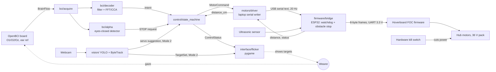

# Architecture

## Data flow



## Process and thread layout (proposal D3)
One Python process on the demo laptop:

| Thread | Module | Rate | Notes |
| --- | --- | --- | --- |
| Main | `interface/flicker.py` | 60 FPS | pygame must own the main thread on macOS |
| Acquisition + decode | `bci/` | every 0.25 s | pulls from BrainFlow ring buffer, emits Intent |
| Control | `control/` | 20 Hz | always emits a MotorCommand; STOP by default |
| Serial writer | `motors/driver.py` | 20 Hz | sends the latest command line to the ESP32; reads distance and status replies |
| Vision (Mode 2) | `vision/` | camera FPS | may run as a separate process sending JSON over localhost UDP |

Threads talk through latest-only `queue.Queue(maxsize=1)` objects passed in at startup (when full, drop the older item before `put_nowait`, so a `STOP` command or fresh `ControlStatus` never waits behind stale items). No globals.

## Folder map
```
pyproject.toml  minimal editable package (`pip install -e .` at kickoff so `python tools/smoke.py` imports cleanly)
bci/            __init__.py, acquire.py, filters.py, ssvep.py, decoder.py, alpha.py, tests/
interface/      __init__.py, flicker.py, widgets.py, tests/
control/        __init__.py, state_machine.py, mapping.py, tests/
motors/         __init__.py, bridge_protocol.py, driver.py, mock_serial.py, teleop.py, tests/
firmware/       bridge/bridge.ino (ESP32), README.md (pin map, flashing notes)
vision/         __init__.py, detect_track.py, servo.py, tests/
shared/         __init__.py, protocol.py (generated from docs/INTERFACES.md at kickoff), tests/
tools/          fake_eeg.py, record.py, analyze.py, smoke.py
app.py          wires everything: python app.py --synthetic --mock  |  python app.py --cyton --serial /dev/cu.X
```
File names are the plan, not code that exists yet. Agents create them during the phases.

## Latency budget (targets)
| Path | Budget |
| --- | --- |
| Gaze -> selection | window 1.5 s + dwell 1.5 s ~ 3 s |
| Look away -> STOP | under 1 s (target loses the window) |
| Eyes closed -> STOP | about 1 s (alpha window) |
| Obstacle -> STOP | next ESP32 loop (about 50 ms), independent of the laptop |
| Laptop hang -> STOP | 200 ms ESP32 watchdog |
| Kill switch -> STOP | immediate, cuts motor power |
